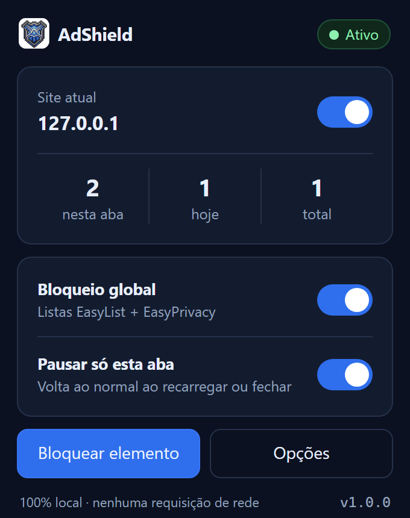

# AdShield

[](https://github.com/ClopesX/adshield/actions/workflows/ci.yml)
[](LICENSE)
[](manifest.json)

Bloqueador de anúncios e rastreadores para Chrome, Manifest V3, **100% local**.
Sem conta, sem telemetria, sem servidor — o código é legível do começo ao fim.



Nasceu de uma auditoria do AdBlock 6.51.0 instalado nesta máquina: o bloqueio era bom, a coleta de
dados era o problema. O resultado está em [docs/AUDITORIA-ADBLOCK.md](docs/AUDITORIA-ADBLOCK.md) e a
arquitetura comparada em [docs/ARQUITETURA.md](docs/ARQUITETURA.md).

## O que ele faz

| Recurso | Situação |
|---|---|
| Bloqueio de rede (EasyList + EasyPrivacy) | 105.669 regras em 6 partes |
| Bloqueio no YouTube | limpa `adPlacements` da resposta do player (mundo MAIN) + 8 regras de rede + CSS + auto-pular |
| Ocultação de elementos | 13.782 seletores genéricos + 8.288 domínios |
| Contador por aba, por dia e por domínio | local (`chrome.storage.local`) |
| Pausar tudo / pausar site / pausar aba | global, persistente e temporária |
| Filtros personalizados (sintaxe ABP) | até 2.500 regras dinâmicas |
| Assinaturas por URL | até 2.500 regras, atualização diária |
| Bloquear elemento (seletor visual) | menu de contexto ou popup, com **Desfazer** no aviso |
| Ver e remover o que você bloqueou | Opções → *Ocultação personalizada* |
| Modo por regra | **esconder** (CSS) ou **remover da página** (apaga o nó do DOM) |
| Página de opções e estatísticas | sim |
| Exportar/importar configuração | sim |
| Telemetria, contas, rede | **nenhuma** (exceto baixar assinatura que você adicionar) |

## Instalar

**Jeito rápido (sem compilar):** baixe o `.zip` da [release mais recente](../../releases/latest),
descompacte e carregue a pasta.

**Do código:**

```bash
git clone https://github.com/ClopesX/adshield.git
cd adshield
```

Depois, nos dois casos:

1. `chrome://extensions`
2. Ligar **Modo do desenvolvedor**
3. **Carregar sem compactação** → escolha a pasta do AdShield (a que tem o `manifest.json`)
4. A primeira ativação leva alguns segundos (o Chrome carrega as regras)

As regras já vêm geradas em `rules/` — só rode `node tools/build.mjs` se quiser atualizar as listas.

## Esconder ou remover um elemento

**Bloquear elemento** (menu de contexto ou popup) cria a regra no modo **esconder**,
`display: none !important`. Resolve a maioria dos casos.

Alguns overlays continuam segurando o scroll mesmo invisíveis: o nó segue no DOM, com
`position: fixed` e `overflow: hidden` no `body`. Para esses, abra
**Opções → Ocultação personalizada**, ache a regra e troque o modo para **Remover da página**.
O nó é apagado do DOM e, quando ele cobria a tela, o scroll é liberado. Como sites recriam esse tipo
de elemento, um observador remove de novo a cada aparição.

| Modo | O que faz | Quando usar |
|---|---|---|
| Esconder | `display: none` | banner, slot de anúncio, seção que não atrapalha |
| Remover da página | apaga o nó do DOM | overlay/modal que trava o scroll ou captura cliques |

## Recompilar as listas

```bash
node tools/build.mjs             # baixa EasyList/EasyPrivacy (cache de 24 h) e gera rules/
node tools/build.mjs --refresh   # força download novo
node tools/build.mjs --offline   # só cache
node tools/build.mjs --budget 28000   # pacote publicável (limite da loja)
```

Depois de compilar, clique em **Recarregar** na página de extensões.

## Verificar

```bash
npm test                  # 20 testes do compilador + 7 de domínio
node tools/check.mjs      # manifest, arquivos e todas as regras
node tools/e2e.mjs        # Chrome real: bloqueio, ocultação, contador, popup, opções
node tools/youtube-check.mjs    # YouTube real: compara o player com e sem a extensão
node tools/compare-youtube.mjs # AdBlock × AdShield no mesmo vídeo, lado a lado
```

O `e2e` precisa de um Chrome instalado e de permissão para abrir um processo próprio (perfil
temporário, sem tocar no seu perfil). Resultado da última execução: **29/29**.

```
ok  extensão carregada — cokllc…
ok  service worker ativo
ok  listas estáticas carregadas — 105369 regras em 2.4s
ok  rulesets ligados — 7/7
ok  anúncio bloqueado — bloqueado
ok  rastreador bloqueado — bloqueado
ok  ocultação cosmética aplicada — display: none
ok  contador por aba registrou bloqueio — selo: "2"
ok  página de popup carrega
ok  página de opções carrega
ok  script MAIN do YouTube registrado — adshield-youtube-main
ok  sanitizador limpa a resposta do player — ads=0 playerAds=0 slots=0 streaming=true
ok  sanitizador limpa ytInitialPlayerResponse — ads=0 streaming=true
ok  campos de anúncio ficam travados em undefined — ads=undefined
ok  clique sintético chega como confiável — true
```

## YouTube

O AdBlock 6.51.0 bloqueia o pedido de `ad_break`, esconde slots por CSS e, quando aparece o muro
antiadblock, **auto-libera o YouTube** (fragmento `yt-wall-detection`). O bloqueio de verdade dele
vem da lista `abp-filters-anti-cv.txt`, que usa *snippets*: `override-property-read`,
`skip-video` e `event-override click trusted`.

O AdShield reproduz os três efeitos em código próprio, no mundo MAIN, antes dos scripts da página:

- **`harden`** — `adPlacements`/`playerAds`/`adSlots`/`adBreakParams` devolvem `undefined` para
  sempre, mesmo que a página reatribua;
- **`skip-video`** — com o player em anúncio, o vídeo vai até o fim (pré-roll de 30 s acaba na hora);
- **clique confiável** — o "Pular" é clicado com eventos que o listener do YouTube vê como
  confiáveis: como o Chrome não deixa falsificar `isTrusted`, entregamos uma fachada que responde
  `true`;
- **muro antiadblock** — é removido e o vídeo destravado, em vez de desistir;
- **JSON** — `fetch`/XHR de `/youtubei/v1/player` já saem limpos, inclusive dentro de
  `ytplayer.config.args.raw_player_response`.

Medição em página real (`node tools/youtube-check.mjs`):

| | sem extensão | com AdShield |
|---|---|---|
| `adPlacements` | 1 | **removido** |
| `streamingData` | presente | presente (player intacto) |
| `video.currentTime` após 9 s | 0 s (anúncio) | 7 s (conteúdo) |

Confronto com o AdBlock no mesmo vídeo (`node tools/compare-youtube.mjs`): 105.669 regras nossas
contra 56.852 estáticas + 2.680 dinâmicas dele, ambos com `adPlacements` removido e vídeo tocando.

Limite honesto: anúncio costurado no vídeo pelo servidor (SSAI) não tem solução por extensão.


## Estrutura

```
ADSHIELD/
├── manifest.json
├── src/
│   ├── common/abp.js              compilador ABP → declarativeNetRequest (usado no build e em runtime)
│   ├── background/service-worker.js
│   ├── content/cosmetic.js        ocultação por domínio + seletor de elemento
│   ├── content/youtube-main.js    mundo MAIN: limpa a resposta do player do YouTube
│   ├── content/youtube.css        ocultação dos anúncios visuais do YouTube
│   ├── popup/, options/, ui/
├── rules/                         gerado por tools/build.mjs
├── data/cache/                    listas baixadas
├── tools/                         build, check, e2e, icons, screenshots
├── tests/
└── docs/                          auditoria e arquitetura
```

## Privacidade, por construção

- Nenhum `fetch` de telemetria, nenhum endpoint de terceiro no código.
- O único caminho de rede é o download de uma assinatura que **você** cadastra.
- Sem `eval`, sem `new Function`, sem código remoto.
- O contador nunca sai de `chrome.storage.local`.

## Licença e créditos

**GPL-3.0-or-later** — texto completo em [LICENSE](LICENSE).

- **Código:** escrito para o AdShield. Nenhuma linha do AdBlock 6.51.0 foi copiada; a auditoria usou
  engenharia reversa de um pacote instalado e formato público de filtros (ABP).
- **Listas:** [EasyList](https://easylist.to/), EasyPrivacy e EasyList Português, **CC BY-SA 3.0**.
  O texto das listas não é redistribuído; as regras compiladas em `rules/` derivam delas e mantêm a
  mesma licença.
- **Marca:** "AdBlock" e "Adblock Plus" pertencem a seus titulares; este projeto não é afiliado nem
  usa as marcas no nome ou nos ícones.

Detalhes e atribuições completas: [ATTRIBUTION.md](ATTRIBUTION.md).

## Publicar uma atualização

Tudo em um comando (versão, testes, zip, commit, push, tag e release):

```bash
npm run release              # 1.2.0 → 1.2.1
npm run release -- minor     # 1.2.0 → 1.3.0
npm run release -- none --refresh   # mesma versão, só atualiza o zip da release
npm run release -- patch --dry-run  # mostra o que faria, sem enviar nada
```

O script `tools/release.mjs` faz, na ordem:

1. sobe `version` no `manifest.json` e no `package.json`;
2. roda os 20 testes e o `tools/check.mjs` (aborta se algo estiver inconsistente);
3. monta `dist/adshield-<versão>.zip` com a extensão pronta para instalar;
4. `git add -A` + commit `release: v<versão>` + `git push`;
5. cria a tag `v<versão>` e a release no GitHub com o zip anexado — se a tag já existir, só troca o
   arquivo (`--clobber`).

Pré-requisitos: `git` e `gh` no PATH, com `gh auth login` feito. No Windows:
`winget install Git.Git GitHub.cli`.

Se preferir fazer na mão, o equivalente é:

```bash
# 1. edite "version" em manifest.json e package.json
node tests/abp.test.mjs && node tools/check.mjs
# 2. o zip sai de tools/release.mjs; ou use a interface do GitHub para anexar
git add -A && git commit -m "release: v1.2.1" && git push
git tag -a v1.2.1 -m "AdShield 1.2.1" && git push origin v1.2.1
gh release create v1.2.1 dist/adshield-1.2.1.zip --title "AdShield 1.2.1" --notes "..."
```


